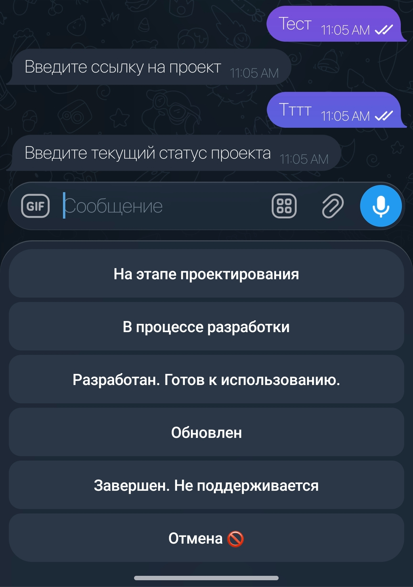

<div align="center">

# 🤖✨ Portfolio Bot

### _Твоё портфолио — теперь в одном сообщении!_

[](https://python.org)
[](https://t.me/your_bot_name)
[](https://github.com)
[](LICENSE)

---


---

</div>

## 🚀 О проекте

> **Portfolio Bot** — это Telegram-бот, который заменяет скучное резюме!
> Отправь `/projects` и получи всю информацию о моих навыках и проектах
> в удобном интерактивном формате. 💬⚡

---

## 🌟 Возможности

| Команда       | Описание                              | Эмодзи |
|:-------------:|---------------------------------------|:------:|
| `/info`       | Главное меню                          | 👋     |
| `/skills`     | Мои технологии и навыки               | 🛠️     |
| `/projects`   | Портфолио проектов                    | 📂     |

---

## 📸 Как это выглядит

<div align="center">

| Главное меню |
|:---:|
|  |

</div>

---

## 🛠️ Стек технологий

<div align="center">


</div>

---

## ⚙️ Быстрый старт

```bash
# 1️⃣ Клонируй репозиторий
git clone https://github.com/your_username/portfolio-bot.git
cd portfolio-bot

# 2️⃣ Создай виртуальное окружение
python -m venv venv
source venv/bin/activate  # Linux/Mac
venv\Scripts\activate     # Windows

# 3️⃣ Установи зависимости
pip install -r requirements.txt

# 4️⃣ Создай файл .env и добавь токен
echo "BOT_TOKEN=your_token_here" > .env

# 5️⃣ Запусти бота! 🚀
python main.py
```

---

## 📁 Структура проекта

```
portfolio-bot/
├── 📄 main.py              # Точка входа
├── 📄 config.py
├── 📄 logic.py
└── 📄 README.md            # Ты здесь! 😎
```

---

## 🎯 Планы на будущее

- [ ] 🌐 Мультиязычность (RU / EN)
- [ ] 🎨 Inline-кнопки с анимацией
- [ ] 📊 Статистика посещений
- [ ] 🤝 Интеграция с GitHub API
- [x] ✅ Базовый функционал
- [x] ✅ Деплой на сервер

---

## 💬 Связь со мной

<div align="center">

[](https://t.me/your_username)
[](https://github.com/your_username)
[](mailto:your@email.com)

</div>

---

<div align="center">

### _Сделано с ❤️ и ☕_

**⭐ Поставь звезду, если проект понравился!**


</div>
